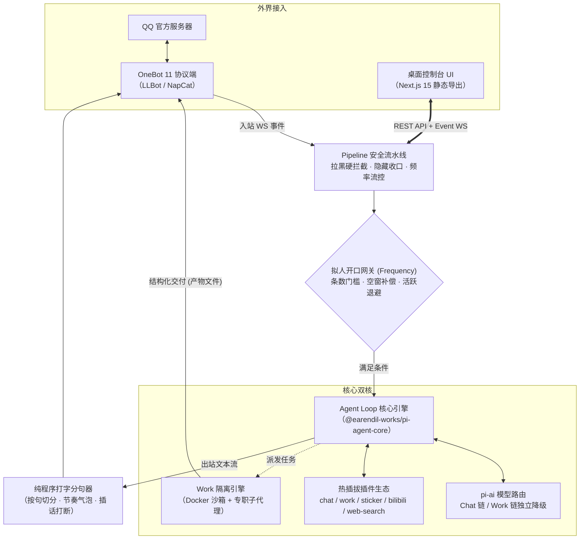

<div align="center">


# Parallelbot

### 聊天与工作并行，拟人与沙箱共生 —— 新一代 QQ Agent 运行时

**Parallel, Not Just a Bot.**  
打破传统机器人“只会机械问答”或“只能闲聊刷屏”的刻板印象。  
日常在群里和私聊中，它是有温度、懂节律、甚至被插话会瞬间闭嘴的真实群友；  
一旦 @ 交代任务，它即刻化身全能工程师：在物理隔离的 Docker 沙箱里调度代码、协同子代理，并将产物直接以文件发回。

[](https://github.com/DDNdles/Parallelbot/actions/workflows/ci.yml)
[](https://github.com/DDNdles/Parallelbot/releases)
[](LICENSE)
[](package.json)
[](test)
[](docker)

</div>

---

## ⚡ 为什么叫 Parallelbot？

> **Parallel（并行）** 不仅是它的名字，更是它的底层哲学：

| 并行维度 | 核心表现 |
| :--- | :--- |
| **💬 闲聊与工作并行 (Chat & Work)** | 摸鱼闲聊与重型任务互不干扰。在群内插科打诨的同时，后台静默拉起容器跑代码，产物直发，互不抢占。 |
| **👥 主代理与子代理并行 (Delegation)** | 面对复杂工程或调研，任务通过 `delegate` 自动分拆给专职子代理（Research / Data / Coding），多线协同推进。 |
| **⛓️ 聊天与工作模型链并行 (Dual-Chain)** | 聊天链与工作链彻底解耦，独立配置供应商、模型与思考强度；各自维护故障转移降级队列，高可用永不掉线。 |
| **🎭 前台拟人与后台掌控并行 (Humanlike & Control)** | QQ 端体验极度自然（分句气泡、打断即停、真表情交互）；桌面端提供 **14 个 Next.js 极客管理面板**，全局状态一览无余。 |

---

## 📸 实机体验

<table>
  <tr>
    <td align="center" width="56%">
      <br/>
      <b>💬 拟人化闲聊</b><br/>
      <sub>真实打字节律 · 仿人类分句气泡 · 插话瞬间打断 · 接梗与吐槽</sub>
    </td>
    <td align="center" width="44%">
      <br/>
      <b>🛠️ 群内零门槛派活</b><br/>
      <sub>自然语言 @ 即可派单 · 独立沙箱执行 · 产物直接打包发回</sub>
    </td>
  </tr>
</table>

<div align="center">
  <br/>
  <b>🖥️ 桌面端 Live Activity Stream</b><br/>
  <sub>逐行实时透视模型思考链、Shell 终端、文件读写与子代理协作，按发起人与任务清晰归档</sub>
</div>

---

## 🚀 双轨核心能力

### 轨一：像真人一样生活（Humanlike Chat）

告别传统机器人的“问一句答一句”与“客服味道歉”，Parallelbot 拥有独立的社交呼吸感：

- **会呼吸的开口判定**：基于 `frequency` 门槛机制，不抢话、不复读。结合群聊活跃度动态积累发言冲动，长时间无人互动时具备指数退避，深更半夜遵循昼夜生理节律。
- **纯程序分句气泡**：不是丢出一大坨格式化 Markdown，而是由程序按句子切分、模拟人类打字速度逐条发送，真实还原群友聊天的碎碎念体验。
- **🚨 核心特性：被插话瞬间打断**：在逐条发出气泡的过程中，如果对方突然发来新消息，系统会即刻掐断剩余未发出的气泡，且未发内容绝不上屏、不入历史。真人聊天时的“被打断就闭嘴”，在此成为现实。
- **真 QQ 表情全链路**：收到群友表情时自动转码为视觉输入理解语义；发送时可自然触发真 QQ 表情段，支持贴表情（React）表态与双击头像戳一戳（Poke）。
- **Canon 与 Overlay 演化记忆**：内置经典人格内核，配合动态演化层。群友的外号、群内专属黑话、长期的互动关系会自然沉淀在本地记忆中。

### 轨二：像工程师一样交付（Sandbox Work）

不只是在聊天框里敲出伪代码，Parallelbot 能真枪实弹跑通任务：

- **无命令负担**：告别 `/work`、`/exec` 等刻板指令。群友或管理员只需 @bot 说出需求（“帮我写个分析某股票行情的图表页面并生成报告”），即可触发 `work_dispatch`。
- **Docker 强隔离沙箱**：执行完全运行在隔离容器内，按会话严格划分独立工作区。内置 Python、Node.js、LaTeX (`xelatex` / `ctex` / `tikz`)、Poppler、Pandas 等科学计算与排版工具栈。
- **专职子代理矩阵**：支持多层子代理分工：
  - `work`：工程主控，编排流程与收敛产物
  - `research`：联网深度调研与事实核查
  - `data`：清洗、统计与图表绘制
- **真实文件闭环交付**：任务结束后，生成的网页（HTML）、报告（PDF）、表格（Excel）或源码归档，将直接以 **真 QQ 文件消息** 逐条发回群聊或私聊，点开即用。

---

## ⚡ 快速开始

提供四种起步方式，根据你的使用习惯自由选择（包内均已内置编译好的桌面端，开箱即用）：

### 方式 A：npm 全局安装（推荐，需自备 Node ≥ 24）

```bash
# 从 Releases 下载最新 tgz 包并全局安装：
npm i -g https://github.com/DDNdles/Parallelbot/releases/download/v0.3.0/ddnoodles-parallel-0.3.0.tgz

# 在任意目录下启动（运行时数据自动保存在当前目录下的 ./data）
parallel
```

### 方式 B：PowerShell 一键安装（Windows 零依赖）

```powershell
# 自动下载 Node 运行时，安装至 %LOCALAPPDATA%\Programs\parallel 并配置好用户环境变量与开始菜单快捷方式：
irm https://raw.githubusercontent.com/DDNdles/Parallelbot/main/scripts/install.ps1 | iex
```

### 方式 C：绿色免安装包（解压即跑）

1. 从 [GitHub Releases](https://github.com/DDNdles/Parallelbot/releases) 下载 `parallel-vX.Y.Z.zip`。
2. 解压到任意目录，双击运行 `parallel.cmd` 即可启动（内置独立 Node 运行时与全部依赖）。

### 方式 D：克隆源码开发

```bash
git clone https://github.com/DDNdles/Parallelbot.git
cd parallel

npm install         # 安装依赖（运行时核心仅依赖 ws 与 pi agent runtime）
npm run build       # 构建桌面端（Next.js 静态导出至 ui/）
npm start           # 启动内核（原生运行 TS 源码，要求 Node ≥ 24）
```

---

## 🔌 接入与首次配置

内核启动后会自动拉起浏览器打开本地管控台：`http://127.0.0.1:3080#token=<uiToken>`。

```
                       ┌────────────────────────────────┐
                       │   Parallelbot 启动 & 自动开箱    │
                       └───────────────┬────────────────┘
                                       │
                                       ▼
                       ┌────────────────────────────────┐
                       │    第一步：环境与依赖自检       │
                       │ （一键下载协议端 / 校验系统依赖）│
                       └───────────────┬────────────────┘
                                       │
                                       ▼
                       ┌────────────────────────────────┐
                       │    第二步：扫码登录 QQ 账号     │
                       │ （有头模式寄生 QQNT，稳定防风控）│
                       └───────────────┬────────────────┘
                                       │
                                       ▼
                       ┌────────────────────────────────┐
                       │    第三步：填入 API Key 即刻起航 │
                       │ （聊天/工作双优先链自由指定模型） │
                       └────────────────────────────────┘
```

1. **环境检查**：首次进入会展示环境看板。协议端（LuckyLilliaBot）可一键自动下载并校验官方哈希。Docker / Python 等仅在开启重度 Work 模式时需要，普通闲聊可直接跳过。
2. **扫码上线**：协议端默认采用 **LuckyLilliaBot（PMHQ 有头注入）** 方案，寄生于本机官方 QQNT，扫码直接登录你准备的 Bot 账号，免除掉线风控困扰。
3. **权限与模型**：在桌面端「用户」页将你的主号设为 `masterIds`，在「模型」页填入你的 LLM API Key，即刻完成部署！

---

## 🎛️ 桌面端 14 联装极客控制台

拒绝把配置埋在复杂的命令行参数或黑盒 JSON 里。Parallelbot 随内核自托管了一套由 **Next.js 15** 驱动的纯净桌面端，沿用极简黑白主题与品牌光标交互：

- 💬 **会话监控流**：实时查看全部群聊与私聊进出站报文、状态标记、手动打断与一键插话。
- 📊 **工作任务抽屉**：可视化跟踪所有 Work 任务的执行状态、活动脊线、Token 消耗与产物文件库。
- 🤖 **模型链编排**：聊天链（`llm.chatChain`）与工作链（`llm.workChain`）独立编排，可为不同模型设置不同的思考强度。
- 📦 **沙箱与存储**：会话文件管理器、过期自动清理（TTL Sweep）、运行配额与网络出网权限开关。
- 🗣️ **拟人与语气调优**：开口条数门槛、打断概率、分群语气学习库增删管理。
- 🛡️ **报错中心与风控**：全链路错误透明回溯、频控计费与拉黑名单硬闸拦截。
- 💾 **即时持久化**：全站所有开关、拖拽条与输入框均支持无感自动保存（即存/防抖落盘），无需手动找保存按钮。

---

## 🧩 协议与生态矩阵

### 协议端接入

| 协议端 | 形态 | 托管支持 | 适用场景 |
| :--- | :--- | :---: | :--- |
| [**LuckyLilliaBot (LLBot)**](https://github.com/LLOneBot/LuckyLilliaBot) | 有头 PMHQ 注入 QQNT | **✅ Windows 自动下载 + 看门狗守护** | **官方推荐**。稳定性高，完美兼容真 QQ 表情与文件收发。 |
| [**NapCat**](https://github.com/NapNeko/NapCatQQ) | 引导注入 QQNT | **✅ Windows 自动下载 + 守护** | 备选方案，支持 WebUI 注入。 |
| **通用 OneBot 11** | 反向 WebSocket | — | Linux / macOS 容器化或自建协议端环境，指向 `ws://127.0.0.1:3001/onebot`。 |

### 模型兼容性（由 `@earendil-works/pi-ai` 驱动）

内核原生支持全球主流模型接口，填入 BaseURL 与 API Key 即可使用：

- **OpenAI 兼容 / Chat Completions**（DeepSeek、Qwen、GLM、Moonshot、MiniMax、Ollama 及各类反向代理）
- **OpenAI Responses** 原生协议
- **Anthropic Messages**（Claude 3.5 Sonnet / Haiku / Opus）
- **Google Gemini** 原生接口（支持流式、函数调用与视觉直通）

---

## 🏗️ 系统架构



---

## 🛡️ 隐私与安全底线

- **100% 数据归属本地**：完全无外部遥测、无数据上报、无需注册任何第三方云端账号。所有的会话记录、记忆数据库、配置与密钥完整保存在你手边的 `data/` 目录。
- **密钥物理隔离**：所有的 API Token 仅保存在本地 `data/secrets.json` 中，代码与插件默认值全为空，打包流水线内置密钥扫描机制。
- **沙箱安全防护**：沙箱文件路径执行字面与 `realpath` 双重越界校验，符号链接试图逃逸至工作区外一律严厉切断；Chat 容器网络默认硬化断网。
- **本地回环安全**：控制台后端默认仅监听 `127.0.0.1`，敏感接口强制校验专用 `uiToken` 与回环 Origin 来源。

---

## 🪪 技术一览

| 维度 | 实现规范 |
| :--- | :--- |
| **运行时** | Node.js ≥ 24（内核直接执行 TypeScript 源码，开发免编译） |
| **Agent Loop 核心** | [`@earendil-works/pi-agent-core`](https://github.com/earendil-works/pi) |
| **模型协议抽象** | [`@earendil-works/pi-ai`](https://github.com/earendil-works/pi) |
| **前端控制台** | Next.js 15 (App Router) + Tailwind CSS + 原生 WebSocket |
| **持久化引擎** | SQLite (with FTS5 全文搜索) + JSONL 增量会话日志 |
| **沙箱隔离** | Docker 容器隔离引擎 / 本地多进程回落 |
| **开源许可证** | **AGPL-3.0-only** |

---

## 🤝 致谢

Parallelbot 的构建离不开优秀开源社区的基石：

- [**pi**](https://github.com/earendil-works/pi)（Pi Agent Harness）— 优雅克制的 Agent 循环与统一模型层引擎，本项目的底层基石
- [**HDS-Interlude**](https://github.com/REcklessNOLOve117/HDS-Interlude) — 拟人层行动容量与节奏判据的设计启蒙（AGPL-3.0，逐行移植声明详见 [THIRD-PARTY-NOTICES.md](THIRD-PARTY-NOTICES.md)）
- [**LuckyLilliaBot (LLBot)**](https://github.com/LLOneBot/LuckyLilliaBot) & [**NapCat**](https://github.com/NapNeko/NapCatQQ) — 卓越稳健的 QQ 协议基础设施
- [**MaiBot**](https://github.com/MaiM-with-u/MaiBot) & [**AstrBot**](https://github.com/AstrBotDevs/AstrBot) — 拟人化参数与群聊交互的优秀探索
- [**Next.js**](https://nextjs.org/) & [**Tailwind CSS**](https://tailwindcss.com/) — 桌面端现代化交互架构

---

<div align="center">

**Parallelbot** —— 聊天时是懂人情世故的赛博群友，工作时是雷厉风行的代码特工。  
*Star 本项目，一起见证下一代 QQ 机器人的无限可能。*

</div>